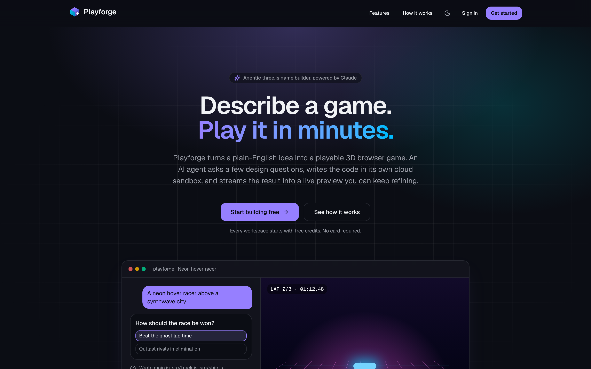
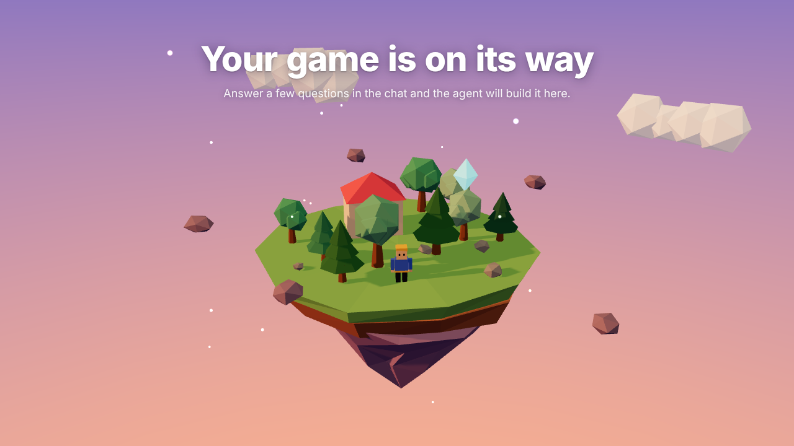
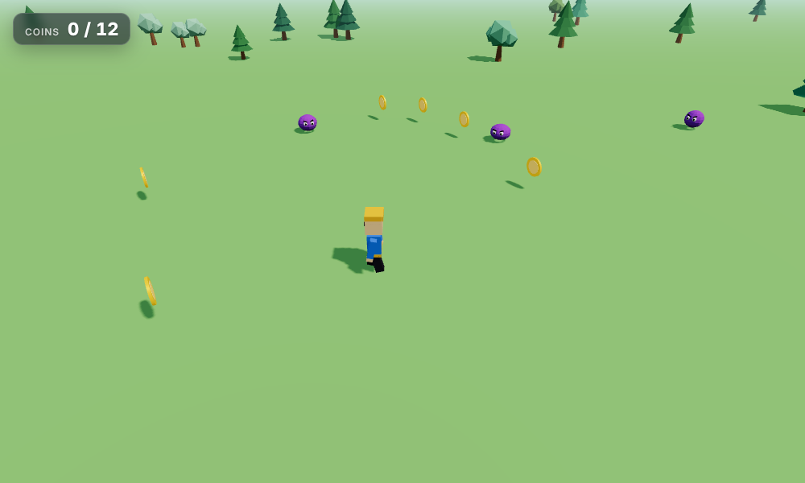
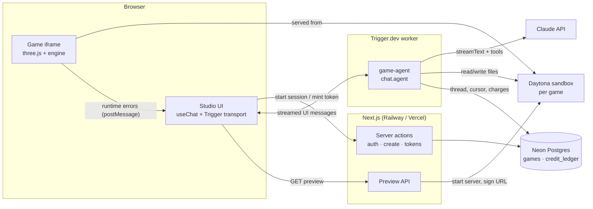

<div align="center">


# Playforge

**An AI game studio in the browser. Describe a game in plain English; an agent designs it with you, writes the three.js code in an isolated cloud sandbox, and streams a playable 3D game into a live preview.**

[](https://github.com/BernieTv/ai-game-generator/actions/workflows/ci.yml)


[Overview](#overview) · [Architecture](#architecture) · [Engineering highlights](#engineering-highlights) · [Run locally](#running-locally) · [Deploy](docs/DEPLOYMENT.md) · [Design notes](docs/ARCHITECTURE.md)

</div>



<table>
  <tr>
    <td width="50%"></td>
    <td width="50%"></td>
  </tr>
  <tr>
    <td align="center"><sub>Every sandbox boots with a live placeholder scene built from the engine toolkit</sub></td>
    <td align="center"><sub>A sample game composed from the engine's input, physics, models and HUD modules</sub></td>
  </tr>
</table>

---

## Overview

Playforge is a full-stack, multi-tenant SaaS application built around a **tool-using AI agent**. A session works like this:

1. **Describe a premise**, for example _"a moth drifting through a dark forest toward a lantern"_.
2. **Answer a short design brief.** The agent asks 3 to 5 multiple-choice questions (core loop, goal, controls, look, feel) through a dedicated `ask_player` tool, so the game is shaped by the player's choices and not by guesswork.
3. **Watch it build.** Claude reads and writes real source files inside a dedicated [Daytona](https://www.daytona.io/) sandbox. Each file operation streams into the chat as it happens.
4. **Play and iterate.** The game runs in a live preview beside the chat and reloads after every turn. Runtime errors inside the game are captured and can be sent back to the agent with one click.

## Features

|                                       |                                                                                                                                                                                         |
| ------------------------------------- | --------------------------------------------------------------------------------------------------------------------------------------------------------------------------------------- |
| **Agentic builder**                   | Claude (Opus, Sonnet or Haiku 5.5, chosen per message) runs a multi-step read/write/verify loop with six typed tools.                                                                   |
| **Design-first briefing**             | A client-side tool (`ask_player`) suspends the agent run until the player answers, then resumes in the same turn context.                                                               |
| **Isolated execution**                | Every game gets its own Daytona sandbox. All file paths are confined to the game directory and validated before anything reaches the sandbox.                                           |
| **Durable, resumable turns**          | Turns run as [Trigger.dev](https://trigger.dev) chat agents, not in a request handler. Builds survive tab closes, and a reload resumes the live token stream.                           |
| **Live preview with error telemetry** | A seeded `report.js` captures runtime errors in the game iframe and posts them to the app over a small `postMessage` protocol.                                                          |
| **Batteries-included game engine**    | A custom, dependency-free ES-module toolkit on top of three.js (input, cameras, arcade physics, particles, HUD, synthesized audio, tweens, state machine) that the agent composes.      |
| **Usage-based billing**               | Every model step is priced from its token usage (uncached, cache-read, cache-write and output separately) and written to an idempotent ledger. Monthly plans run through Clerk Billing. |
| **Team workspaces**                   | Games, sandboxes and credit balances are scoped to Clerk organizations.                                                                                                                 |
| **Production hygiene**                | Strict TypeScript, ESLint, Prettier, Vitest, GitHub Actions CI, structured JSON logs and optional Sentry.                                                                               |

## Tech stack

| Layer          | Technology                                                                           |
| -------------- | ------------------------------------------------------------------------------------ |
| Frontend       | Next.js 16 (App Router, Server Components, Server Actions), React 19, Tailwind CSS 4 |
| AI             | Anthropic Claude via the Vercel AI SDK (`ai`, `@ai-sdk/anthropic`, `@ai-sdk/react`)  |
| Agent runtime  | Trigger.dev v4 `chat.agent` (durable runs, session resume, waitpoints)               |
| Code execution | Daytona sandboxes (filesystem API and a signed preview URL)                          |
| Game runtime   | three.js plus a custom engine toolkit (`game-runtime/engine`)                        |
| Data           | PostgreSQL (Neon) with Drizzle ORM                                                   |
| Auth & billing | Clerk (users, organizations, Clerk Billing)                                          |
| Quality        | TypeScript (strict), ESLint, Prettier, Vitest, GitHub Actions                        |
| Observability  | Structured logs, Sentry (optional)                                                   |
| Hosting        | Railway or Vercel for the web app, Trigger.dev Cloud for the worker                  |

## Architecture



**Request lifecycle of a turn**

1. `createGame` (server action) stores the game with the opening prompt as its first message and redirects to the workspace.
2. The client's Trigger.dev transport calls `startGameSession`. That action authorizes the game against the caller's organization, checks credits, and starts (or rejoins) a session keyed by the game id.
3. On the first message, the agent creates and seeds a sandbox (`onChatStart`). On each turn it persists the thread (`onTurnStart`), streams Claude with the file tools, and charges every step (`onStepEnd`).
4. `ask_player` has no server-side `execute`, so the run waits. The player's choice comes back as the tool output and the agent continues.
5. `onTurnComplete` saves the thread and the stream cursor in one statement. The client reloads the preview, which calls `/api/games/[id]/preview` to wake the sandbox and get a fresh signed URL.

More detail, including trade-offs and security boundaries, is in **[docs/ARCHITECTURE.md](docs/ARCHITECTURE.md)**.

## Engineering highlights

- **Sandbox boundary in one function.** `resolveGamePath` (`lib/agent/paths.ts`) is the only place a model-supplied path becomes a real path. It rejects traversal, absolute paths outside the game, and shell-unsafe characters. Unit tests cover it.
- **Recoverable vs. fatal tool errors.** Bad tool input returns a plain-language result the model can act on in the next step. Infrastructure failures throw and end the turn cleanly.
- **Idempotent money.** Ledger rows carry a unique `(org_id, entry_key)`. Step charges are keyed by the provider's response id, and plan grants by `subscription item + month`, so retries never double-charge or double-grant. Amounts are integer micro-dollars (`bigint`), never floats.
- **Prompt-cache friendly.** The system prompt is static and byte-identical across turns, and cache-read tokens are billed at their discounted rate.
- **Resumable streaming.** The thread and the Trigger.dev event cursor are written atomically, so a reload can never resume past messages the database does not have.
- **Tenant isolation.** Every query is scoped by the Clerk organization from the session, never from client input. A game in another workspace is indistinguishable from a missing one (404).

## Project structure

```text
app/
  page.tsx                    Landing page
  studio/                     Authenticated app: composer, game workspace, billing
  api/games/[id]/preview/     Wakes the sandbox and returns a signed preview URL
components/                   Chat thread, question cards, preview, sidebar, UI primitives
lib/
  agent/                      Model catalog, provider settings, tools, path guard, system prompt
  billing/                    Pricing, idempotent ledger, Clerk Billing sync
  db/                         Drizzle schema and client
  games/                      Server actions, queries, authorization, chat session actions
  sandbox/                    Daytona client, sandbox lifecycle, seeding
trigger/game-agent.ts         The durable chat agent
game-runtime/                 Files seeded into every sandbox (index.html, report.js, engine/)
tests/                        Vitest unit tests
docs/                         Architecture notes and deployment guide
```

## Running locally

**Prerequisites:** Node.js 22+, plus free accounts on Clerk, Neon, Anthropic, Trigger.dev and Daytona. The [deployment guide](docs/DEPLOYMENT.md) walks through each one.

```bash
git clone https://github.com/BernieTv/ai-game-generator.git
cd ai-game-generator
npm install
cp .env.example .env.local   # then fill in the keys
npm run db:push              # create the tables
```

Run the agent worker and the web app in two terminals:

```bash
npm run trigger:dev
```

```bash
npm run dev
```

Open http://localhost:3000, sign up, create a workspace, and describe your first game.

### Scripts

| Command                       | What it does                                      |
| ----------------------------- | ------------------------------------------------- |
| `npm run dev`                 | Next.js dev server                                |
| `npm run trigger:dev`         | Local Trigger.dev worker (required for the agent) |
| `npm run build` / `npm start` | Production build / server                         |
| `npm run check`               | Typecheck, lint and unit tests                    |
| `npm run db:push`             | Apply `lib/db/schema.ts` to the database          |
| `npm run db:studio`           | Browse the database with Drizzle Studio           |
| `npm run trigger:deploy`      | Deploy the agent worker to Trigger.dev Cloud      |

## Deployment

The app is two deployables: the **Next.js web app** (Railway or Vercel) and the **agent worker** (Trigger.dev Cloud). The full step-by-step guide is in **[docs/DEPLOYMENT.md](docs/DEPLOYMENT.md)**.

## Roadmap

- Shareable public play links for finished games
- Version history with one-click rollback of the game directory
- Asset generation (textures and sprites) as an additional agent tool
- Playwright end-to-end suite running against a mocked model

## License

[MIT](LICENSE)
